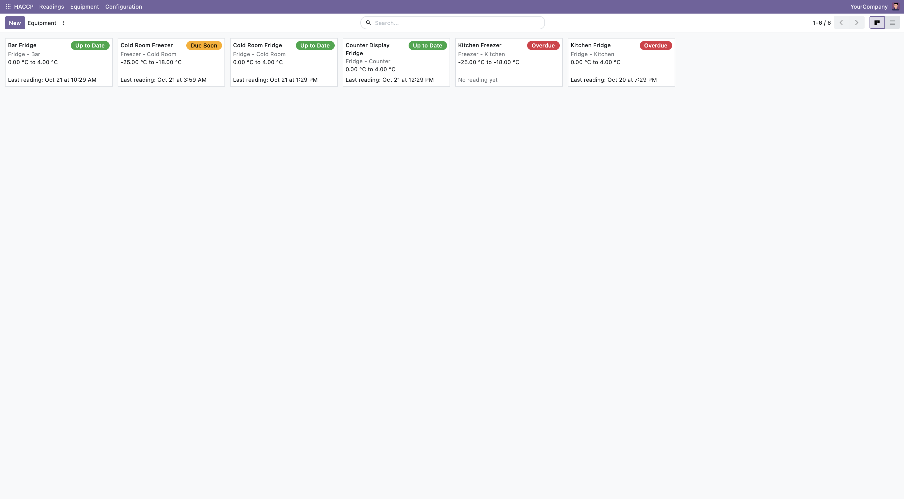
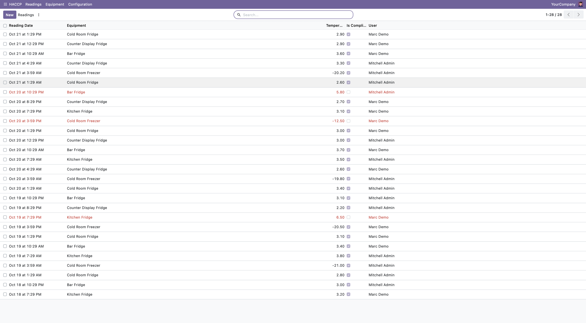
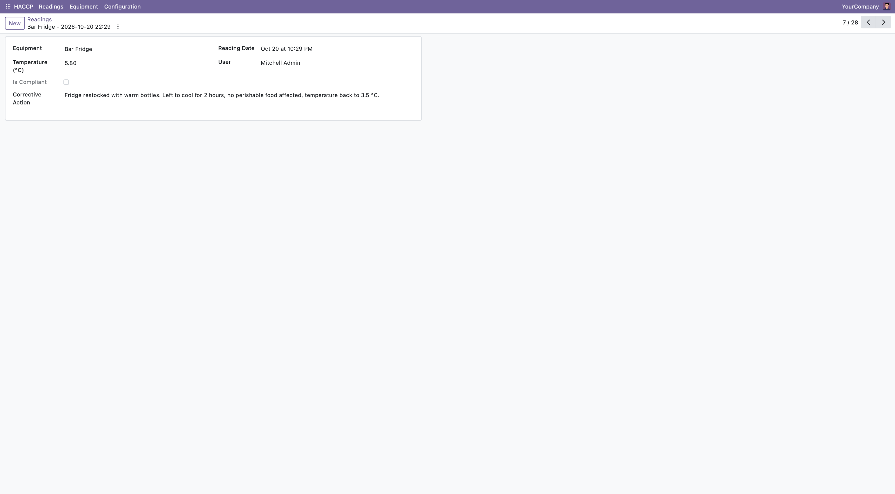

# bs_haccp — HACCP temperature register for Odoo 20

`bs_haccp` is an Odoo 20 Community module that replaces the paper
temperature register of a food business with a simple digital one.

## What it does and why

In Belgium, food businesses must follow HACCP principles and be able to show
the **AFSCA / FAVV** (the Federal Agency for the Safety of the Food Chain)
proof that their cold storage is kept at a safe temperature. In practice this
means someone checks every fridge and freezer regularly, writes the
temperature down, and explains what was done when a value is out of range.

This module does exactly that inside Odoo: staff record readings, the system
tells them immediately if a reading is out of range, and managers can see at a
glance which equipment has not been checked in time.

## Main features

- **Locations**: group your equipment by place (kitchen, cellar, shop...).
- **Equipment**: fridges and freezers with brand, reference, serial number,
  a minimum and maximum temperature, and a check interval in hours.
  The minimum must be lower than the maximum.
- **Temperature readings**: date, user (filled automatically), equipment and
  temperature. Each reading has a readable name such as
  `Fridge 1 - 2026-10-20 08:30`.
- **Compliance**: each reading is automatically marked compliant or not,
  based on the equipment thresholds (limits included).
- **Check state**: each piece of equipment shows *Up to Date*, *Due Soon* or
  *Overdue* depending on its last reading and its check interval.
- **Corrective action**: an out-of-range reading cannot be saved without a
  description of the corrective action taken.
- **Roles**: *Employee* can read locations and equipment and create readings;
  *Manager* can also manage locations and equipment and edit readings.
- **Kanban view** for equipment, with a colored check-state badge.
- **French and Dutch translations** (`fr.po`, `nl.po`).

## Installation (Docker Compose)

Requirements: Docker with Docker Compose.

```bash
git clone <this repository>
cd odoo-dev
docker compose up -d
```

1. Open <http://localhost:8069> and create a database named `dev`.
2. Go to **Apps**, remove the *Apps* filter, search for **HACCP** and click
   **Install**.

The `addons/` folder is mounted in the container, so the module is found
automatically. After a change in a Python file:

```bash
docker compose restart odoo
docker compose run --rm odoo odoo -d dev -u bs_haccp --stop-after-init --no-http
```

(XML-only changes just need the module upgrade. A change in the manifest
`data` list needs a restart first.)

## Running the tests

```bash
docker compose run --rm odoo odoo -d dev -u bs_haccp \
    --test-tags /bs_haccp --stop-after-init --no-http
```

The log ends with `0 failed, 0 error(s)` when everything passes.

## Screenshots

| Equipment kanban | Readings list | Reading form |
| --- | --- | --- |
|  |  |  |

## Roadmap

- PDF register that can be printed and shown during an inspection.
- Fixed check times per site (for example 08:00 and 16:00) instead of a
  simple interval.
- Integration with the Maintenance app.
- Keep the thresholds that were valid at reading time, so changing an
  equipment's limits does not change the compliance of old readings.
- Chatter tracking on equipment and readings.
- Continuous integration (run the tests on every push).

## License

LGPL-3
